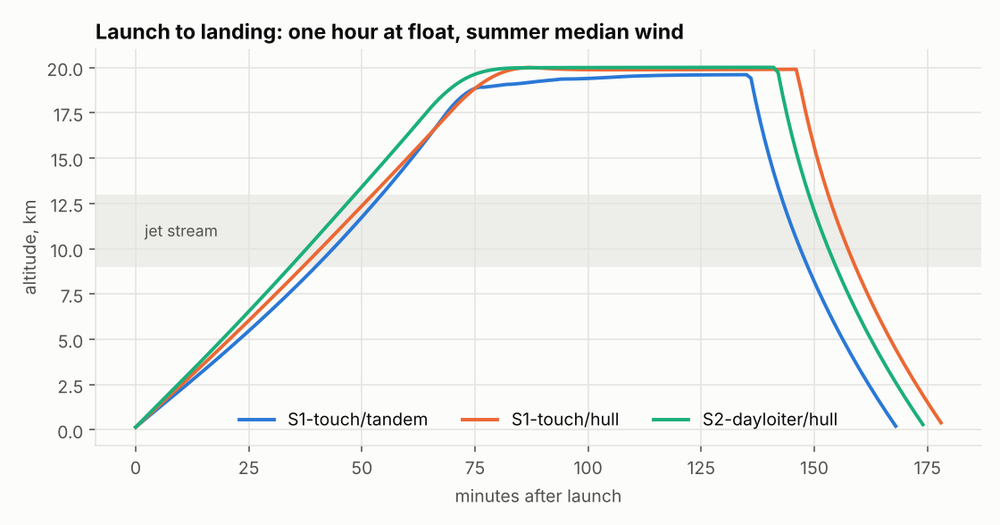

# STRATO: the stratospheric article

Status: executable design definition, opened 2026-11-21. Nothing here has flown.
Scope: the smallest, cheapest powered airship that reaches the stratosphere,
flies there under control, and can be built in quantity.

CARRIER-P0 answers one question indoors: can a buoyant carrier recover an
aircraft. STRATO is the next article, and it answers a different one: can we
put the carrier *where a carrier is worth having* — above weather, above
air traffic, with a 500 km radio horizon — for the price of a mid-range
drone. Every number below is a model output; the models are in
[`aiur/strato`](../../aiur/strato/) and every one of them runs from the
command line.

## The answer in one table

| Step | What it proves | Vehicle | Gross | Unit cost (first / 1000th) | Gas per launch |
| --- | --- | --- | ---: | ---: | ---: |
| **S1 touch** | a powered airship reaches 20 km and flies under control for an hour | 14.8 m film hull, 106 m³, *or* two 1600 g latex cells on a 6.4 m boom | 8.7 kg | $2,250 / $940 | $18 of hydrogen |
| **S2 day loiter** | holds station all daylight against the summer median wind, 2 kg payload | 17.4 m film hull, 172 m³, 0.4 m² solar | 14.1 kg | $2,730 / $1,190 | $29 |
| **S3 diurnal** | survives the night | 22.9 m hull, 390 m³, ballast 1.9 kg/night | 32 kg | $3,840 first | $66 |
| **S4 carrier** | 10 kg of payload: release-only aircraft and relay radios | 25 m class superpressure hull | 50 kg | film-limited, see log | — |

S1 and S2 are the funded definition. S3 and S4 close on paper and are
carried to show where the wall is (overnight film, see the
[design log](design-log.md)).



## The vehicle

**The hull is the air frame.** A 20 µm polyethylene film hull, launched
about 10 % full and filled by its own gas expanding fourteen-fold on the way
up (the HiSentinel launch). At float it is a pressure vessel at 20 Pa — and
at that pressure its wrinkling moment is six times the bending the equipment
puts on it, so there is no keel. Fins are sealed air-beams that are soft on
the ground and stiffen as the outside pressure falls away. Equipment hangs
on a webbing spine: payload forward, heated avionics bay amidships, and a
self-contained propulsion pod at the stern with one slow 0.74–0.87 m
propeller on a two-axis gimbal.

**Avionics are the Ukrainian FPV parts bin**, on purpose: an ArduPilot H7
board, a u-blox M10, a 1 W sub-GHz MAVLink link, in-house 6SnP 21700 packs,
a $40 arm64 companion running ROS 2 — about $620 of avionics and termination electronics, 0.31 kg,
6 W. The one thing that is not negotiable is the flight-termination unit:
its own processor, cells, GNSS, barometer and radio, with no conductor
shared with the autopilot. See [hardware.md](hardware.md).

**Hydrogen, not helium.** At this scale it is a $18 launch instead of a $360
one, it is what most weather services already fly, and nobody is underneath.

## What the models found

Six findings changed the design. Each is reproducible; the commands are in
the [design log](design-log.md).

1. **Scaling the indoor P0 blimp does not work.** A TPU envelope with a
   ballonet closes at 30 m and 75 kg. The same mission closes at 14.8 m and
   8.7 kg with a flaccid-launched film hull.
2. **A slack gas cell has no altitude stiffness.** Venting to stop the climb
   left the first design sinking 3 km in an hour. The hull now spills on its
   own and float is held by thrust-vector trim plus a 3 % ballast reserve.
3. **Thin air makes the hull Munk-unstable.** With conventional fin area the
   stern gimbal was saturated 76 % of the time. Fins grew to 0.60 V^(2/3).
4. **Free lift had to triple.** Small vehicles climb slowly (rate goes as
   mass^(1/6)); at the textbook 15 % a quarter of summer flights drifted past
   the range fence before reaching float. At 45 %, 99 % make it.
5. **Copper down the spine was the wrong answer.** A 9.5 m power run needs a
   kilogram of wire. The stern pod got its own pack and a CAN bus.
6. **Overnight is a film problem, not an energy problem.** Monolithic film
   cannot hold the day–night pressure swing; the options are ballast every
   night or a laminate that costs $10,000.

## What it cannot do

- **Winter.** At 50°N the 20 km winter median is ~15 m/s. S2 sustains 6.
  The Monte Carlo reaches float on 18–22 % of winter draws. This is a
  summer and turnaround-season vehicle until it is much larger.
- **Come home.** It lands 60–100 km downrange in median wind (130–150 km at
  the 90th percentile). Recovery is a chase, and cost per flight assumes 70 %
  of hardware comes back.
- **Fly under Part 101 exemptions.** Suspended mass is 5.5–6.2 kg against
  the 12 lb (5.4 kg) exempt ceiling, and a *powered* airship is not a free
  balloon in any case. See [prototype-ladder.md](prototype-ladder.md).
- **Recover aircraft at altitude.** A quadcopter cannot hover at 0.089 kg/m³.
  The stratospheric carrier is release-only; the dock stays a low-altitude
  capability.

## Run it

```
python -m aiur.strato.sizing        # the design ladder
python -m aiur.strato.trades        # every trade study
python -m aiur.strato.ascent        # launch-to-landing reference flights
python -m aiur.strato.flight6dof    # handling and station-keeping
python -m aiur.strato.campaign --design S1-touch/hull --flights 200 --seed 1
python -m aiur.strato.harness --check-budget
python -m aiur.strato.link
python -m aiur.strato.cost
python tools/strato_export.py       # URDF, STL, Gazebo models, design-point JSON, BOMs
python tools/strato_plots.py        # figures (needs matplotlib)
```

ROS 2 (Jazzy): see [ros.md](ros.md).

## Map

- [Design log](design-log.md) — the iterations and what each one changed
- [Hardware](hardware.md) — structure, components, every connection
- [Prototype ladder](prototype-ladder.md) — what to build first, gates, regulation
- [ROS 2](ros.md) — workspace, topics, running a mission, Gazebo cross-check
- [References](references.md) — sources, and what could not be verified
- [`hardware/strato/`](../../hardware/strato/) — netlist, BOMs, sized design points
