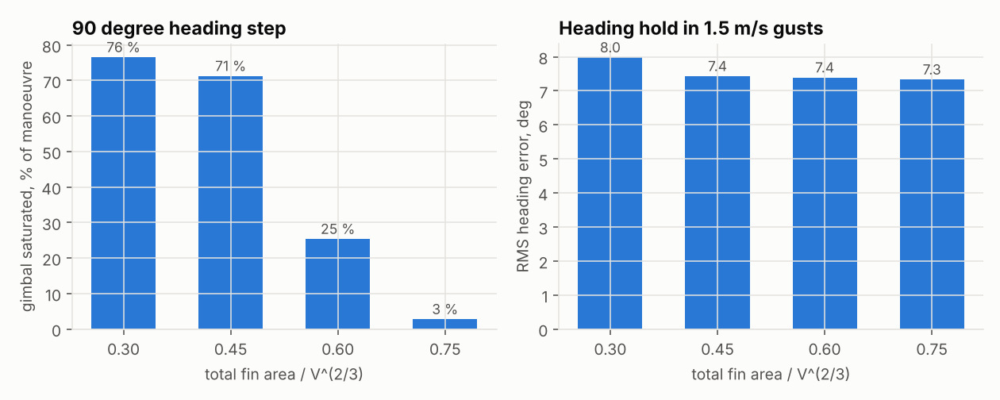
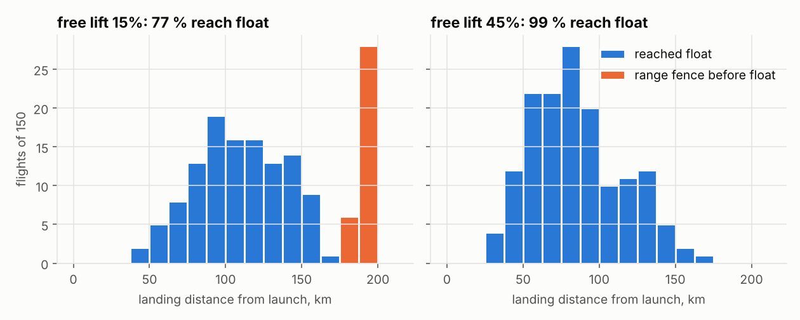

# STRATO design log

Each entry is one loop: a design, the model that broke it, and the change.
Commands reproduce the numbers. Nothing here has been measured on hardware;
every coefficient tagged `[estimate]` in the code is a bench test waiting to
happen (listed at the end).

## Rev A — scale up the P0 blimp

*Design.* The obvious move: the P0 indoor airship is a TPU envelope with an
air ballonet. Make it bigger.

*What broke.* Air at 20 km is 7.3 % of sea-level density. A ballonet that
keeps the hull taut all the way up must fill 93 % of it at launch, and
published allowances put a ballonet at +40 % of hull mass.

```
python -m aiur.strato.trades      # rev_a_scaled_p0
```

| Envelope | Volume | Length | Gross | Film |
| --- | ---: | ---: | ---: | ---: |
| TPU 50 µm + ballonet | 912 m³ | 30.4 m | 75 kg | 49 kg |
| TPU-coated ripstop + ballonet | 1,297 m³ | 34.2 m | 107 kg | 72 kg |
| **LLDPE 20 µm, flaccid launch** | **106 m³** | **14.8 m** | **8.7 kg** | **2.5 kg** |

Two thirds of Rev A is envelope, and TPU's glass transition is near −40 °C
in a −56 °C environment.

*Change.* Drop the ballonet. Launch 10 % full and let the gas fill the hull
(HiSentinel flew six times this way). Use balloon-grade polyethylene, the
only cheap film that is ductile at −80 °C.

## Rev B — what carries the bending?

*Question.* The brief calls for an air-framed airship. Should there be an
inflated keel?

```
python -m aiur.strato.trades      # airframe
```

For the S2 hull with all equipment in one gondola the bending moment is
227 N·m. An air-beam keel that carries it weighs 2.7 kg; a carbon tube,
5.5 kg. The hull itself, at 21 Pa, carries it for nothing — wrinkling moment
goes as p·r³, so the fattest tube on the vehicle wins by orders of
magnitude. Spreading the equipment along a spine cuts the moment to 51 N·m
against a 324 N·m capacity at the 20 Pa relief setting.

*Change.* The hull is the air frame. Air-beams are used where there is no
hull to lean on: the four fins. A fin beam sealed at 3 kPa on the ground
sits at 73 kPa gauge at 20 km, so each gets a relief valve — and the fins
are stiffest exactly when the hull has finally taken shape.

## Rev C — the float controller sank the vehicle

*Design.* Vent gas approaching the target altitude to arrive without
overshoot.

*What broke.*

```
python -m aiur.strato.ascent
```

The first runs reached 19.6 km and then sank to 16.6 km within the hour.
Trace: the controller vented while the gas was 9 K warmer than the air in
still conditions; at float the vehicle started flying at 3 m/s, forced
convection cooled the gas by 2 K, lift fell 0.9 %, and a slack cell has no
restoring force at all — it just keeps sinking.

*Change.* A zero-pressure hull is never vented early; it fills and spills,
which is self-regulating. Altitude is held by tilting the stern thrust
vector (`FloatController.trim`), with a 3 % droppable ballast reserve for
when trim saturates. Float then holds within ±30–80 m. Cost: the S1 hull
runs trim near full authority most of its hour at float, which is in the
energy budget but is the first thing to measure on a real flight.

## Rev D — the hull would not point

*Design.* Fins at 0.30 V^(2/3), the conventional airship ratio. One
gimballed stern thruster for control; no moving surfaces.

*What broke.*

```
python -m aiur.strato.flight6dof
```



| Fins / V^(2/3) | Open-loop time to 10° yaw | Gimbal saturated in 90° turn | Trim pitch |
| ---: | ---: | ---: | ---: |
| 0.30 | 5 s | 77 % | 36° |
| 0.45 | 7 s | 71 % | 33° |
| **0.60** | **14 s** | **25 %** | **6°** |
| 0.45 + ruddervators | 7 s | 1 % | 0° |

At 6 m/s the dynamic pressure is 1.6 Pa. The Munk moment scales with it and
so do the fins, but thrust-vector authority does not — it is 31 N·m, and
the Munk moment is about 430 N·m per radian. With small fins the pitch axis is
unstable too: the pendulum (CG about a metre below the hull axis) loses to Munk
above about 4 m/s.

*Change.* Fixed fins at 0.60. Ruddervators at 0.45 handle better, but they
put servos and hinges on inflated film at −60 °C; fixed fins keep every
actuator in the heated stern pod. Ruddervators stay on the list for S3.

*Also found.* A uniform gust does nothing to a neutrally buoyant hull — the
air accelerates the vehicle with it. The first gust test reported exactly
zero heading error. The disturbance is the gust *gradient* along the hull;
with that modelled, RMS heading error is 2° in 0.5 m/s turbulence and 7° in
1.5 m/s.

## Rev E — the first netlist failed thirteen checks

```
python -m aiur.strato.harness
```

- **Spine copper.** 5 V servo leads dropped 8 % over 4.5 m, and the real run
  from an amidships bay to the stern is 9.5 m. The ESC lead alone would have
  been ~0.9 kg of 12 AWG. *Change:* the stern pod carries its own pack,
  regulator and power monitor, and a DroneCAN node turns three PWM runs and
  two sense lines into one twisted pair. The pod is now a module on one
  connector, and losing propulsion power cannot brown out the autopilot.
  The autopilot moved from an F405 to an H743 board for the CAN port.
- **Cold.** DS18B20 probes stop at −55 °C. Outside probes are PT1000 RTDs
  read by amplifiers inside the heated bay.
- **Barometer.** The SPL06/BMP-class barometers on these boards are rated to
  300 hPa — about 9 km. An external MS5611 (rated to 10 mbar, 31 km) is the
  primary.
- **Termination cells.** Two cutters firing together exceeded what three AA
  lithium cells deliver. Six cells, 3S2P.
- **Independence.** The checker walks the conductive graph from the
  termination unit and must reach nothing else. It reaches nothing; the one
  crossing is an opto-isolated heartbeat.

## Rev F — the radio and the range fence

```
python -m aiur.strato.link
python -m aiur.strato.campaign --design S1-touch/hull --flights 120 --free-lift 0.15
```

- A 100 mW ELRS receiver has 10 dB of margin out to ~130 km. The vehicle is
  routinely 100 km away. *Change:* 1 W sub-GHz MAVLink module (589 km, i.e.
  to the horizon). The termination unit's LoRa link reaches the horizon at
  22 dBm. 5.8 GHz video does not close at 100 km without a tracking dish.
- At 15 % free lift the climb averages 2.4 m/s and takes over two hours. In
  the summer Monte Carlo 23–26 % of flights hit the 150 km range fence
  inside the jet stream and were cut down before float.



| Free lift | Reach float | Time to float (p50) | Landing range p50 / p90 |
| ---: | ---: | ---: | ---: |
| 15 % | 74 % | 126 min | 123 / 193 km |
| 30 % | 95 % | 98 min | 92 / 150 km |
| **45 %** | **99 %** | **86 min** | **80 / 130 km** |
| 60 % | 99 % | 79 min | 74 / 118 km |

*Change:* 45 %. The extra hydrogen is cents and spills at float. Winter
stays at ~20 % regardless — that is wind, not ascent rate.

## Rev G — overnight

```
python -m aiur.strato.trades      # overnight
```

The gas runs ~5 K warm by day and ~6 K cold at night. Sealed, that is a
450–600 Pa swing on a 5,500 Pa ambient.

| Approach | Closes? | Size | Note |
| --- | --- | --- | --- |
| Zero-pressure LLDPE 38 µm + ballast | yes | 390 m³, 32 kg | 1.9 kg of ballast per night; $3,840 |
| Superpressure, monolithic LLDPE/EVOH/PET | **no** | — | film would need 35–45 plies |
| Superpressure UHMWPE laminate | yes | 233 m³, 19 kg | envelope alone ~$10,500 |

*Decision.* S3 is not funded. The cheap way through is the one Loon took —
a tendon-reinforced (pumpkin) polyethylene envelope where load tapes, not
film, carry the pressure — and that is its own structural model and its own
test article. S1 and S2 are day flights and do not need it.

## Where the model was checked

- **Lamb added-mass factors** reproduce Munk's NACA Report 184 table to
  three figures (k1 0.082, k2 0.860, k′ 0.608 at fineness 4).
- **Hull drag** matches the Cheeseman/Hoerner form within 3 % at Re 1.5×10⁶;
  the 1.8× appendage factor is the published one.
- **JP Aerospace Tandem** flew two 1.8 m propellers and managed 6 kt at
  ~29 km. The tandem model needs 100 W to sustain 3 m/s at 20 km with
  0.77 m propellers. Same regime.
- **Gazebo** (`ros2 launch aiur_description gz_check.launch.py`): the stock
  `LighterThanAirDynamics` + `Buoyancy` systems give a terminal airspeed of
  6.18 m/s against 6.00 expected (S2) and 3.14 against 3.00 (S1), and an
  initial acceleration within 1 %. Off its rail, the finless Gazebo hull
  tumbles, as Munk says it must.
- **ROS 2 vs batch.** The same mission through the ROS nodes reaches float
  at 5,168 s and lands 64.5 km out; the batch run says 5,172 s and 64.6 km.

## Estimates that a bench must replace

In rough order of how much they could move the design:

1. Fin lift-curve slope on an inflated low-aspect fin at Re ~10⁵ (2.2/rad
   assumed). Decides whether 0.60 is enough. *Tow test or car-top rig.*
2. Film optical properties — solar absorptance 0.03, IR emittance 0.18 for
   20 µm polyethylene. Sets superheat, hence spill and night behaviour.
3. Propeller efficiency at blade Re ~2–3×10⁴ (0.43–0.53 modelled).
   *Vacuum-chamber thrust stand.*
4. Ascent drag coefficient of a 10 %-full hull (0.65 assumed).
5. Seam strength and creep of heat-sealed 20 µm film at −60 °C.
6. Stratospheric wind statistics for the actual launch site: the tables are
   an envelope from published ranges, not ERA5 for a place.
7. Motor heat rejection at 5.5 kPa (a third of sea level assumed).
8. Li-ion capacity in the bay as actually insulated.
