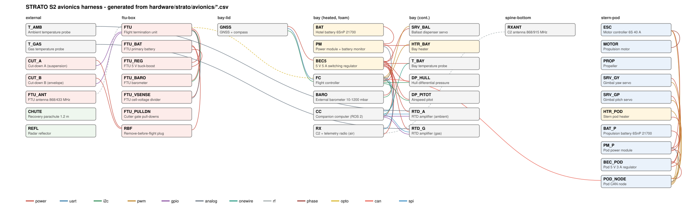
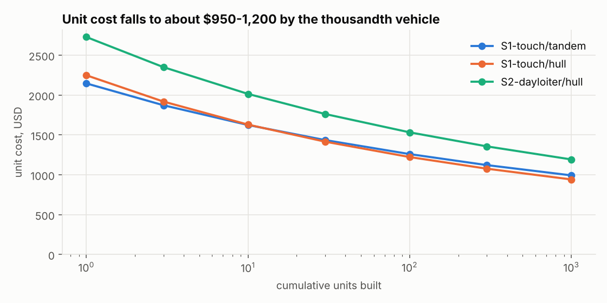

# STRATO hardware: structure, components, connections

Status: design definition for the S1 and S2 articles. Source of truth for
the avionics is data, not this page:
[`hardware/strato/avionics/`](../../hardware/strato/avionics/) holds
`components.csv`, `ports.csv` and `connections.csv`, and
`python -m aiur.strato.harness` reviews them. Purchasable BOMs are generated
into [`hardware/strato/bom-*.csv`](../../hardware/strato/).

## Layout

```
                      fill/relief port
   nose cap ___________________|______________________________
          /                                                    \____  fins x4 (sealed air-beams)
         (            20 um LLDPE hull, 20 Pa at float              >=[ stern pod ]--(propeller)
          \___________________________________________________ ____/    gimbal 2-axis
              |            |              |                  |
   ==========[payload]====[bay + FTU]====================================  webbing spine
              forward      under CV        9.5 m: one CAN twisted pair
```

| | S1 touch (hull) | S2 day loiter |
| --- | ---: | ---: |
| Hull length × diameter | 14.8 × 3.7 m | 17.4 × 4.4 m |
| Volume / film area | 106 m³ / 138 m² | 172 m³ / 191 m² |
| Fin area, total | 13.4 m² | 18.5 m² |
| Gross mass (no gas) | 8.73 kg | 14.12 kg |
| Film + seams + fittings | 3.87 kg | 5.21 kg |
| Fins | 1.34 kg | 1.77 kg |
| Spine and rigging | 0.37 kg | 0.41 kg |
| Propulsion pod (motor, prop, ESC, gimbal) | 0.41 kg | 0.45 kg |
| Batteries | 0.46 kg (6S1P) | 1.39 kg (6S3P total) |
| Solar | — | 0.40 kg, 0.41 m² |
| Avionics + bay + harness | 0.58 kg | 0.65 kg |
| Payload | 0.50 kg | 2.00 kg |
| Recovery + ballast + margin | 1.21 kg | 1.83 kg |
| Propeller | 0.74 m | 0.87 m |
| Cruise / dash airspeed | 3 / 5 m/s | 6 / 10 m/s |
| Cruise / dash electrical | 5 / 18 W | 40 / 188 W |
| Hydrogen at launch | 11.2 Nm³ | 18.1 Nm³ |

The tandem alternative for S1 (two 1600 g latex cells, 6.4 m carbon boom,
two 0.77 m propellers) weighs the same 8.8 kg and costs about the same, with
no custom envelope at all — but it needs 100 W to hold 3 m/s where the hull
needs 5 W, because two 4.7 m spheres are a terrible shape. It is the fastest
way to a first flight and a dead end after it.

## Structure

- **Hull.** Twelve gores of 20 µm linear low-density polyethylene, impulse
  heat-sealed, with a taped load patch every 1.5 m along the keel line for
  the spine. Hoop load at the 20 Pa relief setting is 43–51 N/m against a
  100 N/m sustained allowable (20 % of a 500 N/m short-term ultimate).
  Single-use: the cut-down opens a rip panel.
- **Relief/fill port.** A weighted flap at the low point: gas spills when the
  hull is full. No active vent on the hull.
- **Fins.** Four at 45°, each a film skin over two sealed TPU-ripstop
  air-beam spars inflated to 3 kPa on the ground, with 10 kPa relief valves
  (a sealed beam would reach 73 kPa at float). No moving surfaces.
- **Spine.** 12 mm UHMWPE webbing under the hull. At launch the hull is a
  bubble at the top and everything hangs in a vertical chain, stern pod
  lowest; the propeller is a folder for that reason.
- **Pods.** Expanded-polypropylene shells. The avionics bay is 25 mm of
  extruded polystyrene around the electronics with a 10 W film heater.

## Avionics architecture



Three systems, deliberately separate:

**1. Flight (bay).** Matek H743-class board running ArduPilot does state
estimation, actuator output and failsafes. A Radxa Zero 3W-class arm64
companion runs ROS 2 and the float/station-keeping logic and talks MAVLink
over a UART. One 1 W sub-GHz module carries MAVLink to the ground. External
MS5611 barometer, u-blox M10 GNSS in airborne <1 g mode, two PT1000 probes
(ambient, gas), two Sensirion differential-pressure sensors on S2 (hull
pressure and pitot).

**2. Propulsion (stern pod).** Its own 6S pack, power monitor, 5 V
regulator, ESC, two gimbal servos, a 3 W heater, and a DroneCAN node. The
only connection to the rest of the vehicle is a CAN twisted pair on one
connector. A pod can be swapped on the launch field.

**3. Termination (FTU box).** LilyGO T-Beam Supreme-class board: ESP32-S3,
SX1262 LoRa, u-blox M10. Six lithium AA primaries. Its own MS5611. Two
hot-wire cutters: one drops the equipment string onto its parachute, one
opens the hull. It runs `aiur.strato.guidance.Geofence` — range, altitude,
flight time, loss of heartbeat, loss of link, ground command — and nothing
else. It shares no power rail, no bus and no ground-referenced signal with
systems 1 and 2; the single crossing is an opto-isolated heartbeat, and the
harness checker fails the build if that ever stops being true.

### Why these parts

| Choice | Reason | Source of the practice |
| --- | --- | --- |
| ArduPilot on an H7 board | Open, MAVLink-native, CAN for the pod | ArduPilot is the autopilot in Ukraine's long-range drones |
| MAVLink + CAN as the only internal interfaces | Any radio or pod becomes a swap-in module | Sine.Link wiring practice; Brave1's 2026 push for a unified cartridge connector |
| 1 W sub-GHz link, band chosen per site | 100 mW closes to 130 km; the vehicle lands 100 km out | Frequency agility is the one constant of the Ukrainian RF environment |
| 6SnP 21700 packs welded in-house | $65–90 per pack, no vendor lock | Wild Hornets' pack shop |
| $40 arm64 companion, not a Raspberry Pi 5 | Pi prices rose three times in 2026 | — |
| External MS5611 | The only cheap barometer rated above 9 km | HAB community practice |
| Separate termination unit on primaries | Two independent terminations are the regulatory norm, and the autopilot must not be able to veto its own cut-down | Part 101 Subpart D; SERA Appendix 2 |
| Hydrogen | $18 against $360 per launch; helium supply was disrupted in 2026 | Most weather services |
| Release-only payload bay | Aerostat and mothership release is proven in service; recovery onto a carrier is documented nowhere | Dovbush, GOGOL-M, Aerobavovna |

### Connections

Every wire is a row in
[`connections.csv`](../../hardware/strato/avionics/connections.csv):
56 connections among 37 components on S2. By bus:

| Net | From → to | Carries |
| --- | --- | --- |
| `VBAT_RAW`, `VBAT` | hotel pack → power module → 5 V regulator, bay heater | 22 V, 0.5 A peak |
| `5V` | regulator → FC, companion, radio, GNSS, barometer, RTD amps, dp sensors, ballast servo | 5 V, 1.9 A peak of 5 A |
| `MAVLINK_CC` | FC UART1 ↔ companion | MAVLink 2, 921,600 baud |
| `MAVLINK_RF` | FC UART2 ↔ radio | MAVLink over the C2 link |
| `GNSS_UART`, `I2C_FC` | FC ↔ GNSS; FC ↔ barometer 0x77, compass 0x0D, dp 0x25 / 0x26 | |
| `SPI_CC`, `CS_A`, `CS_G` | companion ↔ two MAX31865 RTD amplifiers | ambient and gas temperature |
| `SPINE_CAN` | FC CAN ↔ pod node, 9.5 m | DroneCAN: throttle, gimbal, pod heater, pod pack telemetry |
| `VPOD_RAW`, `VPOD`, `5V_POD` | pod pack → monitor → ESC, pod regulator → servos, node | 22 V, 9.2 A peak |
| `FTU_RAW`, `FTU_3V3`, `I2C_FTU` | AA cells → cutters, regulator → FTU, FTU barometer | isolated |
| `CUT_A_GATE`, `CUT_B_GATE` | FTU → cutter MOSFETs | |
| `HEARTBEAT` | FC → FTU, opto-isolated | the only crossing |

### What the review checks

`python -m aiur.strato.harness` — currently PASS on S1 and S2:

- every wire lands on a declared port; single-use ports are used once;
- supply voltage inside each part's rating;
- rail peak load ≤ 70 % of the source; wire current ≤ 60 % of sea-level
  ampacity (thin air cools wire badly); voltage drop ≤ 5 % of the rail;
- no I²C address used twice on a bus;
- each part rated for the temperature of where it is mounted (bay 0 °C,
  pods −20 °C, outside −65 °C);
- termination conductively isolated (graph reachability);
- mass and power totals equal to what the sizing model assumes
  (`--check-budget`).

Five warnings remain and are accepted: parts sitting exactly at their cold
rating (companion, FTU, gimbal servos, pod pack). They are the items to
cold-soak first.

## Radio links from 20 km

| Link | Margin at 100 km | Range with 10 dB in hand | Role |
| --- | ---: | ---: | --- |
| mLRS 868/915 MHz, 1 W | 27.6 dB | horizon (589 km) | C2 + telemetry |
| ELRS 900 MHz, 100 mW | 12.2 dB | 129 km | rejected as primary |
| LoRa SF10, 22 dBm | 25.6 dB | horizon | termination unit |
| wfb-ng / OpenIPC 5.8 GHz, 500 mW, 24 dBi dish | −8.9 dB | does not close | payload video needs a tracking dish or a lower band |

As a relay the vehicle sees 54 km of ground at a 20° elevation mask, 108 km
at 10°, and 504 km to the geometric horizon.

## Cost

| | First unit | 100th | 1,000th | Per flight at 1,000th* |
| --- | ---: | ---: | ---: | ---: |
| S1 tandem | $2,150 | $1,260 | $990 | $850 |
| S1 hull | $2,250 | $1,220 | $940 | $810 |
| S2 hull | $2,730 | $1,530 | $1,190 | $930 |

\*Hydrogen, single-use film, 70 % hardware recovery, chase crew. With helium
add $300–480.

Parts are 61–65 % of the first unit and ~80 % of the thousandth: the same
shape as Ukrainian FPV production, where parts are ~90 % at volume. The
envelope is $100 of film and nine hours of sealing on the first unit; it is
the labour that the learning curve removes. Production splits three ways
(film sealing, electronics, final assembly), as Aerobavovna's does.


